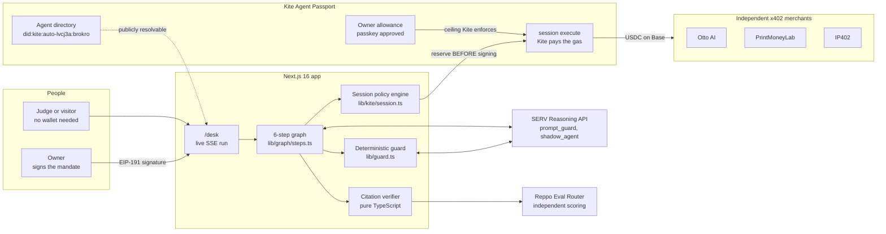
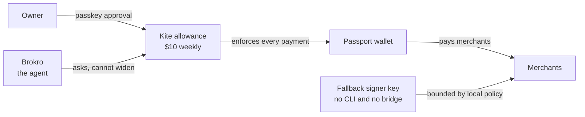

# Brokro

**Your agent gets a signed mandate, not your wallet.**

Brokro is a procurement desk for AI agents. You write a brief, set a spending ceiling, and the agent shops real `x402` merchants inside that ceiling, cross-examines what they sold it, and **refuses to call the job done when a claim does not match the bytes the merchant actually returned**. Everything is measured by one number: **how much of the dossier survives verification**, because a finding that cannot be traced to a merchant's own response is deleted rather than shipped.

Built for the OpenServ SERV Hackathon Edition 02 · **Track 02 — Kite** · Not affiliated with Kite AI, OpenServ, Otto AI, PrintMoneyLab or IP402 · App: **[trybrokro.vercel.app](https://trybrokro.vercel.app)** · Demo: **[youtu.be/4NYNXsAoUm8](https://youtu.be/4NYNXsAoUm8)** · Code: `github.com/mrnetwork0001/Brokro` (private; access on request)

**Judges, start here:** open **[trybrokro.vercel.app/desk](https://trybrokro.vercel.app/desk)**, leave every default alone and press **Execute Bounded Procurement**. The run streams six steps live. The two things worth watching are the vendor that gets quarantined before any signature exists, and the receipt table at the end that names which key paid for each purchase.

---

## What actually happens when you press the button

Six steps. Four of them can refuse to proceed.

| Step | What it does | Where |
| --- | --- | --- |
| **1 · screen_catalog** | Deterministic rules plus SERV `serv_prompt_guard` read every vendor's own manifest. A vendor that embeds instructions in its description, or that pays to a burn address, is quarantined **before** it is ever offered a payment. | `src/lib/guard.ts` |
| **2 · plan_basket** | SERV `/v1/responses` plans a basket against the budget, streaming its reasoning summary to the desk as it goes. | `src/lib/serv.ts` |
| **3 · settle_x402** | The mandate is evaluated and the spend reserved **before any signature exists**. Then Brokro buys: internal supply nodes, and on request four real third-party merchants it does not control. | `src/lib/graph/steps.ts` |
| **4 · cross_examine** | SERV `serv_shadow_agent` writes the dossier, and may only cite fields that exist in a response a merchant actually returned. | `src/lib/serv.ts` |
| **5 · verify_dossier** | Pure deterministic verification. Every citation is resolved back to a vendor, a field path and a quoted value. *A finding that cites a real field but misquotes its value is deleted, not flagged.* | `src/lib/graph/steps.ts` |
| **6 · anchor_audit** | Unit economics against the $0.05 wholesale bundle price, then the dossier goes to Reppo's Eval Router for independent scoring. | `src/lib/partners/reppo.ts` |

### The merchants are real businesses

Four of them, discovered through Kite's `ksearch` catalog, priced in USDC on Base at $0.001–$0.002 a call. Brokro does not own them and cannot make them behave:

| Merchant | Sells | Price |
| --- | --- | --- |
| Otto AI · Token Security | honeypot, tax, mint authority, liquidity lock | $0.001 |
| Otto AI · DEX Token Price | live price, 24h change, volume, FDV, liquidity | $0.001 |
| PrintMoneyLab · Kimchi Premium | Upbit vs Binance spread via live FX | $0.002 |
| IP402 · Geolocation & ASN | IP geolocation and ASN ownership | $0.001 |

They go through the same mandate as everything else. A merchant that spikes its price, swaps its payee, demands an unauthorized chain, or cannot answer about the mandate's target at all is refused before a signature exists. Being real buys it no extra trust.

## Why Kite is not decorative here

Brokro's claim is bounded spending. Kite is what makes the bound real rather than self-asserted.

- **No Passport, no identity.** The agent is published at `did:kite:auto-lvcj3a:brokro` and resolves for anyone who runs `kpass agent directory get did:kite:auto-lvcj3a:brokro`. It is not a string in our database.
- **No Passport, no ceiling we cannot move.** On the Passport rail Brokro holds **no private key at all**. It asks the owner's Passport to pay, and Kite enforces the allowance the owner approved with a passkey. The agent cannot raise that ceiling because it has nothing to raise it with (`src/lib/kite/passport.ts`).
- **The limit lives outside the agent.** Lower the allowance in Kite's dashboard and the figure on `/desk` drops on the next read. No redeploy, no restart, no cooperation from Brokro required.
- **Refusal happens before a signature.** `reserveSessionSpend` evaluates host scope, asset lock, payee, per-transaction cap, session total and TTL, then takes an atomic lease. There is no window in which an over-budget payment exists as a signed object (`src/lib/kite/session.ts`).

### Two rails, and the receipt says which one paid

| | `eip3009-signer` | `kite-passport-session` |
| --- | --- | --- |
| Who holds the key | Brokro, a hot mainnet key | nobody; Passport pays |
| Who enforces the limit | Brokro's own policy engine | **Kite** |
| Can the agent widen it | it holds the key, so in principle yes | no |
| Where it runs | anywhere, including serverless | needs the `kpass` CLI, directly or through the bridge |

`BROKR_SETTLEMENT_RAIL=auto` prefers Passport. A runtime with no CLI forwards to a configured bridge rather than reaching for a key, and only falls back to the signer when there is neither. Every receipt records `settlementRail` and quotes the policy that was enforced, because *whose key moved this money* is the first question an auditor asks.

## Architecture

Four layers: the **desk** (one Next.js app), the **reasoning** (SERV), the **money** (x402 over Kite Passport or an EIP-3009 signer), and the **verifier**, which is deliberately plain TypeScript with no model in it.



### Who holds which key



| Key | Lives in | Can | Can never |
| --- | --- | --- | --- |
| Owner's passkey | the owner's device | set and change the allowance | be used by Brokro |
| Kite allowance | Kite's backend | pay merchants within the ceiling | exceed what the owner approved |
| Brokro | no key on the Passport rail | request a payment | raise its own ceiling |
| Fallback signer | server env, last resort only | sign EIP-3009 within local policy | bypass `reserveSessionSpend` |

### A real purchase, end to end

This ran on Base mainnet on 12 November 2026 through the Passport rail:

```
merchant   Otto AI · Token Security
amount     0.001 USDC
tx         0xb5563b5e338ab94750134d18252c96aadfe9cdf4909ddad828961f31419dd35b
block      56,422,906
payer      0x86d97809E8f481B58CcbCe4f0d26C28F91413E2C   (Passport wallet)
gas        paid by Kite's relayer, not by Brokro
allowance  10 -> 9.999 USD
result     HTTP 200, GoPlus security report returned
```

Three more settled the same day through the signer rail, from a wallet holding **zero ETH** — the facilitator broadcasts and pays gas, which is what makes an agent wallet practical to fund:

| Merchant | Paid | Transaction |
| --- | --- | --- |
| Otto AI · Token Security | 0.001 USDC | `0x6b5f2f808e0a3db1996a2368e3bdff943e5158c3b543e1d2bea49816dff8e1e4` |
| Otto AI · DEX Price | 0.001 USDC | `0x530519ba8f100ee7e5b9f95ca16a17708ecafae5013cabdee7921aed76886a22` |
| PrintMoneyLab · Kimchi | 0.002 USDC | `0x9ad6fe9eacfa4488172f25e32b53aaf40acc1ff7cea5dcae3bb9048aec92eb4b` |

Reproduce them with `npm run settle:external`.

### The deployed site holds no key either

`trybrokro.vercel.app` runs on Vercel, which cannot execute a CLI. Rather than
give a public deployment a hot mainnet key, it forwards payments to a host that
can:

```
trybrokro.vercel.app          no key, no CLI
        |  POST /api/passport/pay  + bearer
        v
brokro.38-49-213-208.sslip.io  kpass + TLS, no key either
        |  kpass session execute
        v
Kite Passport                  enforces the owner's weekly allowance
        |
        v
Otto AI                        real merchant, USDC on Base
```

A payment over that whole path, on 12 November 2026:

```
tx         0x61298b6612cdb30c9a23d84541da7e93635746fa3ad904364dcabdd3774b10f8
block      56,434,229 on Base, status success
transfer   0.001 USDC  Passport wallet -> Otto AI
gas        paid by Kite's relayer
allowance  9.999 -> 9.998 USD
```

The bridge is deliberately narrow, and each of these was checked against the
live endpoint rather than asserted:

| Request | Result |
| --- | --- |
| no bearer | `401 unauthorized` |
| wrong bearer | `401 unauthorized`, byte-identical |
| **correct bearer**, host `evil.example.com` | `403 host_not_payable` |
| correct bearer, Otto AI | paid |

The third row is the one that matters: holding the real secret still does not
let a caller redirect the allowance somewhere else. And the ceiling itself lives
in Kite, so a fully compromised bridge cannot spend past what the owner
approved with a passkey.

## Safety

- **Policy is evaluated before a signature exists.** Eight refusal codes: `session_expired`, `session_endpoint_forbidden`, `session_asset_forbidden`, `payment_target_forbidden`, `session_rule_exceeded`, `session_total_exceeded`, `payment_nonce_replay_detected`, `target_not_servable`.
- **A merchant that cannot answer is refused rather than paid.** A token-security desk pointed at an address with no bytecode on its own chain takes the money and returns HTTP 404, leaving the payment held and nothing delivered. Brokro checks the target is a deployed contract on the merchant's chain before it signs.
- **Spend reservations are atomic leases.** Concurrent calls on one session cannot race past `maxTotalAmountUsd`; there is a test that runs them in parallel and checks.
- **The verifier contains no model.** Citation resolution, field-path checking and quoted-value comparison are plain TypeScript. A model can write a dossier but cannot talk the verifier into accepting a claim.
- **The agent cannot assert its own authorization.** `passkeyVerified` defaults to `false` and a session records `ownerAuthorization` as `none`, `eip191-wallet-signature` or `kite-passport-passkey`. An earlier version hardcoded `true`; that is exactly the claim a spending-limit product cannot afford to get wrong.
- **A signature that was not broadcast says so.** An unfunded wallet still produces a cryptographically valid EIP-3009 authorization. Receipts distinguish `SETTLED ON-CHAIN` from `SIGNED, NOT BROADCAST` and carry the facilitator's own reason, rather than leaving it to be inferred from a missing hash.
- **Tests:** 23 of 23 pass, run 12 November 2026 (`ℹ tests 23 / ℹ pass 23 / ℹ fail 0`). Five of them cover the bridge guards alone.

## What is real and what is not

| Real | Not real |
| --- | --- |
| Four independent x402 merchants, their live prices and payloads | Internal supply nodes are Brokro's own priced endpoints |
| On-chain USDC settlement on Base, transactions above | Two catalog entries are deliberate attack fixtures (`ZeroFee Instant Audit Pro`, `FlashChain Low-Cost EVM Scanner`) used to prove the guard refuses them |
| `did:kite:auto-lvcj3a:brokro`, resolvable by anyone | The directory shows **0 approved signing keys** — the runtime binding is pending the owner's approval, so the agent cannot yet sign as itself |
| The $10 weekly allowance, enforced by Kite | Kite Chain (`eip155:2366`) settlement — there is no mainnet route to USDC.e, so the Kite leg signs but does not broadcast |
| SERV Reasoning, every step | Dolphin inference — `DOLPHIN_API_KEY` is unset, so `osint-brief` reports `deterministic-github-sensor` |
| Reppo Eval Router scoring | |

## Tech stack

Next.js 16.3.5 (App Router, Turbopack), React 19.2.8, TypeScript 5, viem 2.56, `@x402/core` and `@x402/evm` 2.29.0, SERV Reasoning API (`gpt-6-luna` guard, `gpt-5.4-mini` planner and arbiter), Kite Agent Passport CLI `kpass` 6.13.2, Pieverse x402 facilitator, Reppo Eval Router, Base mainnet (`eip155:8453`), Kite mainnet (`eip155:2366`). No database: runs are held in memory and on receipts.

## Run it locally

```bash
npm install
cp .env.example .env.local
npm run dev            # http://localhost:3000
npm test               # 23 tests, no network required
npm run typecheck
npm run diag           # Kite RPC, Pieverse, kpass and SERV key health
```

| Variable | What it does |
| --- | --- |
| `SERV_API_KEY` | **Required.** SERV Reasoning. Without it the reasoning steps cannot run. |
| `KITE_NETWORK` | `mainnet` (default, `eip155:2366`, USDC.e) or `testnet`. |
| `BROKR_SETTLEMENT_RAIL` | `auto` (default) prefers Kite Passport, then the bridge, then the signer. `passport` or `signer` pin one. |
| `BROKR_PASSPORT_BRIDGE_URL` / `_SECRET` | Lets a serverless deployment pay through a host that has the CLI. Set only the secret on that host to serve the rail; set both on the caller. |
| `BROKR_KITE_AGENT_DID` | The published agent to show on the desk and record on receipts. |
| `BROKR_BUYER_PRIVATE_KEY` | Only used on the signer rail. Leave unset when running through Passport. |
| `BROKR_MERCHANT_PAY_TO` | Where Brokro's own $0.05 wholesale endpoint is paid. |
| `BROKR_EXTERNAL_SETTLEMENT` | `preflight` (default) policy-checks real merchants without signing. `on` settles for real. `off` skips them. |
| `BROKR_ALLOW_SIGNED_SANDBOX` | `auto` lets an unfunded wallet fall back to a locally verified signature. Keep `off` when real money must move. |
| `BROKR_DAILY_OUTFLOW_USD` | Hard daily ceiling across all runs. |
| `REPPO_API_KEY` | Independent dossier scoring. Unset disables step 6's evaluation. |
| `DOLPHIN_API_KEY` | Open-weight OSINT inference. Unset falls back to a deterministic sensor. |

To use the Passport rail, install `kpass`, sign in, and set an allowance:

```bash
curl -fsSL https://agentpassport.ai/install.sh | bash   # read it first
kpass signup init --email you@example.com --output json
kpass agent create --uid your-agent --kind buyer --output json
kpass agent init --output json
kpass allowance status --output json                   # set the ceiling in the dashboard
```

## Deploying

`kpass` is a local CLI, so the Passport rail needs a long-lived host. A
serverless deployment does **not** have to give up the keyless rail for that
reason: point it at a host that has the CLI and it forwards payments there.

1. **On the host with the CLI** (VPS or container): install `kpass`, log in,
   approve an allowance, and set `BROKR_PASSPORT_BRIDGE_SECRET`. That alone
   turns on `POST /api/passport/pay`; without it the route refuses to serve.
   Put it behind TLS, since the bridge will not pay a non-HTTPS target.
2. **On Vercel**: set `BROKR_PASSPORT_BRIDGE_URL` and the same secret. Leave
   `BROKR_BUYER_PRIVATE_KEY` unset, so there is no key to fall back to.
3. Set the rest of the variables above. `NEXT_PUBLIC_*` are inlined at build
   time. Do not copy `PORT` or `BROKR_URL` from a local file: a deployed site
   that advertises `127.0.0.1` as its public origin is the bug
   `public-url.ts` exists to prevent.
4. `next start` reads `PORT` from the environment, not from `.env.local`.

The desk states which rail is live, so a deployed site never differs silently
from the demo.

1. Set the environment variables above. `NEXT_PUBLIC_*` are inlined at build time.
2. On a VPS: install `kpass`, authenticate, approve an allowance, set `BROKR_SETTLEMENT_RAIL=auto`.
3. Fund whichever rail you chose: the Passport wallet for the Passport rail, `BROKR_BUYER_PRIVATE_KEY`'s address for the signer. Neither needs native gas.
4. `npm run build && npm start`.

## Repository map

```
src/app/                  landing (/), /desk, /pricing, /receipts, /receipt/[runId]
src/app/api/              status, sessions, procure/stream (SSE), arena, receipt/[runId],
                          eval/[evalId], ecosystem, x402/procure, x402/vendors/[slug]
src/app/.well-known/      x402 discovery manifest for Brokro's own priced endpoint
src/lib/graph/steps.ts    the 6-step procurement graph
src/lib/guard.ts          deterministic vendor screening + prompt-injection quarantine
src/lib/kite/session.ts   Kite Passport session policy engine, atomic spend leases
src/lib/kite/passport.ts  Kite Passport settlement rail: identity, allowance, payment
src/lib/kite/passport-bridge.ts  bridge guards: constant-time bearer, host allowlist
src/app/api/passport/     pay + status, served by a host that has the kpass CLI
src/lib/kite/x402-buyer.ts    x402 client: 402 challenge, EIP-3009, settlement receipt
src/lib/kite/x402-server.ts   x402 server for Brokro's own wholesale endpoint
src/lib/kite/kpass.ts     kpass/ksearch CLI adapter: catalog discovery, environment probe
src/lib/partners/         external-merchants (real third parties), catalog, reppo, dolphin
src/lib/serv.ts           SERV Reasoning: prompt_guard, shadow_agent, /v1/responses
src/lib/public-url.ts     public origin resolution; never advertises a wildcard bind address
src/lib/__tests__/        23 tests: session policy, guard + verifier, public URL, bridge guards
scripts/settle-external.mjs   reproducible third-party settlement proof
scripts/kite-diag.mjs     connectivity diagnostics
```

## Credits

Next.js scaffold from `create-next-app`. `@x402/core` and `@x402/evm` are Coinbase's x402 reference packages. Kite Agent Passport, the `kpass` CLI and the Pieverse facilitator are Kite's. SERV Reasoning is OpenServ's. Otto AI, PrintMoneyLab and IP402 are independent merchants with no relationship to this project. No prior Brokro code: everything here was written for this hackathon.

---

Brokro is an independent hackathon project and is **not affiliated with** Kite AI, OpenServ, or any merchant it buys from. Spending limits are real and enforced, but this is demo-scale software: do not point it at a wallet you would mind losing.
